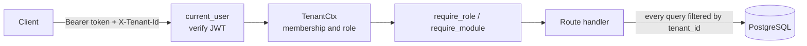

# Studio platform

[](https://github.com/GalHavshush/studio-platform/actions/workflows/ci.yml)

A multi-tenant backend for small coach-led studios (BJJ, MMA, pilates, yoga, CrossFit, dance).

Most studio software is built around bookings and payments. This project is built around a different idea: **coaches build a shared history of each participant**. After a class the coach files a report, with a private note per attendee. Over time the studio, and the member, build on one record instead of scattered memories and chat messages.

It is a learning project, built step by step from a written roadmap, with Claude Code as a pair programmer. Every step is reviewed, tested and committed by me, and the design decisions below are the part I care most about.

**Stack:** Python 3.14, FastAPI, SQLAlchemy 2 (async), PostgreSQL, Alembic, Pydantic, argon2, JWT, pytest, ruff, uv, GitHub Actions. A mobile app (Expo / React Native, with a TypeScript client generated from the OpenAPI schema) is the next milestone.

## What it does today

- **Studios and roles.** One account can belong to several studios with a role in each (owner, coach, member). Roles are cumulative.
- **Schedule.** Class types, sessions, cancellations, archiving, UTC storage with timezone-aware input only.
- **Attendance, kept apart from plans.** An RSVP is what someone *plans* to do. Attendance is what *happened*. They are separate records and separate endpoints.
- **Booking module.** A studio can switch on capacity limits with a waitlist that promotes people automatically.
- **Class reports and participant notes.** Coaches write a report with notes per attendee, saved atomically. A note can be shared with the member it is about.
- **Participant timeline.** One entry per class (booking, attendance, summary, notes), newest first, cursor-paginated.
- **Account deletion.** Anonymizes the account and erases what is about the person, while keeping the studio's own class history. Required by App Store and Google Play.

The API is documented interactively at `/docs`, `/redoc` and `/scalar` when the server runs.

## Architecture at a glance



A modular monolith: one FastAPI app, one Postgres database, one router per area (`sessions`, `bookings`, `attendance`, `reports`, `participants`, `timeline`, ...). No queues, caches or microservices, because nothing here needs them yet. Authentication, tenant resolution and role checks are FastAPI dependencies, so a route declares what it requires in its signature and cannot forget to check.

## Design decisions

### 1. Tenant isolation is enforced in three layers, and CI fails if one is skipped

All studios share one schema; every tenant-owned row carries a `tenant_id`.

- **Request layer.** The studio comes from the `X-Tenant-Id` header, but the header is never trusted: `TenantCtx` verifies that the caller has a membership in that studio and uses *that* role. The studio is never read from a request body.
- **Query layer.** Every query filters by the verified tenant. A session, participant or class type from another studio gets the **same 404** as one that does not exist, so ids cannot be probed.
- **Database layer.** Cross-studio links are impossible even if application code is wrong: parent tables expose `UNIQUE (tenant_id, id)` and child tables reference the pair with composite foreign keys, so Postgres itself refuses an RSVP in studio A that points at a session in studio B.
- **Guardrail.** A test registry lists every tenant-scoped route. A new route that is not registered, or that does not reject a member of another studio, fails CI.

### 2. Authentication: short-lived JWTs, rotating refresh tokens, reuse detection

- Access tokens are JWTs that live 15 minutes. Refresh tokens are opaque random strings, valid 30 days, and stored only as hashes.
- Every refresh **rotates** the token. Presenting an already-used token means it was probably stolen, so the whole token family is revoked and both the thief and the owner must log in again.
- Concurrent refreshes of one account could each pass the check and fork a family, so a row lock on the user serializes them (tested with real concurrent transactions).
- Passwords use argon2, run in a thread pool so the deliberately slow hash does not block the event loop. Unknown email, wrong password and no password all return the identical 401, and a dummy hash is verified for unknown emails so response time does not reveal which emails exist.

### 3. A race condition, proved first and then fixed

Two people booking the last seat could both succeed: both count the seats, both see one free, both insert. No `if` in application code can close that gap.

1. A test reproduced it deterministically using a barrier that holds both requests between the check and the write. It was committed as a strict expected-failure, so the bug was documented in the suite.
2. The fix locks the session row (`SELECT ... FOR NO KEY UPDATE`) before counting, so the second request waits and then sees the committed result. The test flipped to passing.
3. The lock is *no key* on purpose: it excludes other changers (RSVPs, capacity edits, cancellation) but not plain attendance inserts that merely reference the row through a foreign key. A test checks that attendance is not blocked while a booking holds the lock.
4. The mirror-image bug, two simultaneous cancellations leaving a seat empty while someone waits, has its own test.

### 4. Privacy is a design input, not a filter at the end

- **Fail private.** A note is staff-only unless explicitly shared, and re-saving a note without the flag makes it private again. An unknown role gets the member view.
- **Filter in the query.** What a member must not see is never fetched, so a later bug in serialization cannot leak it.
- **One rule, one place.** "Which class summaries may a member read?" lives in a single function used by the report endpoint and the timeline, with a test that the two always agree.
- **No side channels.** On a member's timeline a class that has only a private note is omitted entirely, since even an empty entry would reveal that such a note exists. A member asking for someone else's participant gets the same 404 as for an id that does not exist.
- Free-text fields reject NUL characters at the edge, because Postgres cannot store them and the client would otherwise get a 500.

### 5. Pagination that stays correct while data changes

The timeline uses **keyset pagination** on `(starts_at, id)`, not `OFFSET`. A class added while someone scrolls cannot shift the pages and repeat an item, and page 50 costs the same as page 1. The id is a tie-breaker (tested with five classes at the same instant), and the query fetches one extra row to know whether a next page exists. Each page costs four queries however long it is, so there is no N+1.

### 6. Deleting an account without breaking the studio's records

Deleting a user outright would break every report, note and RSVP that points at them. Instead the account is **anonymized in place**: same id, so foreign keys keep working, but the email becomes `deleted-<id>@deleted.invalid`, the name and password are gone and all sessions are revoked immediately. Notes *about* the person and their upcoming bookings are erased (their seat goes to the next person on the waitlist, in the same transaction). Class reports, past attendance and authored records are kept without a name. The whole policy lives in one file, `app/deletion.py`, so it can change in one place if legal advice differs.

### 7. Optional features per studio

Studios switch capabilities on through a `modules` list (for example `booking`). A dependency, `require_module`, guards the routes, so a studio that never enabled booking cannot be affected by seat limits, and new modules do not touch the core.

### 8. Time

Times are stored in UTC. The API rejects timestamps without an offset instead of guessing a timezone, and returns UTC. Studios carry their own timezone for display.

## How it is tested

The suite has about 465 tests and runs in CI against a real Postgres, never mocks.

- **Fast tests roll back.** Each test runs in a transaction that is rolled back, so tests are isolated and quick.
- **Concurrency tests really commit.** The few tests about locks and races use separate connections and real commits.
- **Races are made deterministic.** A barrier holds requests at the exact interleaving under test instead of hoping for timing, and a helper proves a request is *waiting on a lock* rather than sleeping.
- **Mutation checks by hand.** For each feature the code is deliberately broken in several ways; every mutation must fail a test, and mutations that survive revealed missing tests (an off-by-one in pagination was found this way).
- **Manual end-to-end runs.** Before milestones close, the API is exercised with hundreds of real `curl` requests against a throwaway database. That run found the NUL-character 500, an attendance loophole, and duplicate class names, all since fixed with tests.
- Migrations are tested up, down and up again, and `alembic check` confirms models and migrations agree.

## Roadmap

Milestone 1 (the coaching core, above) is complete. Next: an Expo / React Native app using a TypeScript client generated from the OpenAPI schema, then the studio-facing features (timezone-aware schedules, push notifications, invitations, Sign in with Apple and Google, and store submission requirements such as in-app account deletion).

<details>
<summary><b>Project structure</b></summary>

```
.github/workflows/ci.yml     CI: ruff + pytest for the API, tsc for the app, on every push and pull request
docker-compose.yml           local Postgres (port 5434)
app/                         Expo (React Native, TypeScript) client
├── src/app/                 screens (expo-router: one file = one route)
├── src/api/                 the typed API client: client.ts, schema.d.ts (generated), contract-check.ts (calls that must NOT compile)
├── openapi.json             snapshot of the API's schema, the input of the generated types
└── .env.example             EXPO_PUBLIC_API_URL, the API address the app calls
api/                         FastAPI backend (Python, managed with uv)
├── app/
│   ├── main.py              FastAPI app, the /health endpoint, the /scalar docs page, mounts the routers
│   ├── auth.py              POST /auth/login (access + refresh token), POST /auth/refresh, POST /auth/logout
│   ├── class_types.py       GET/POST /class-types, PUT /class-types/{id}, POST /class-types/{id}/archive and /unarchive (a studio's class types; writes are owner-only; archived ones are hidden by default; each has an attendance mode, rsvp or booking)
│   ├── sessions.py          POST/GET /sessions, GET/PATCH /sessions/{id}, POST /sessions/{id}/cancel; the helpers the other session files share (own_session, is_staff)
│   ├── bookings.py          PUT /sessions/{id}/rsvp (going / not_going / maybe; seats are limited in booking mode, with a waitlist and its promotion)
│   ├── attendance.py        POST /sessions/{id}/attendance (attended or not; check-in opens 15 min before start)
│   ├── reports.py           PUT /sessions/{id}/report (the coach's class report, with a private note per attendee, saved in one transaction), GET /sessions/{id}/report (staff: the whole report; a member: only the summary, and only if they attended)
│   ├── participants.py      GET /participants/{id}/notes (the notes coaches wrote about a participant: staff see all, a member only the notes shared with them about themselves)
│   ├── timeline.py          GET /participants/{id}/timeline (a participant's classes, newest first, with booking, attendance, summary and notes; cursor-paginated; staff see all, a member only their own and what was shared)
│   ├── tenant.py            GET /tenant (the studio named by X-Tenant-Id, with its enabled modules)
│   ├── me.py                GET /me (profile + studio memberships of the logged-in user), DELETE /me (delete the account, confirmed with the password)
│   ├── deps.py              shared dependencies: current_user (verifies the Bearer token), TenantCtx (X-Tenant-Id + membership role), require_role (owner > coach > member), require_module (studio has the module on), is_staff (coach or owner)
│   ├── export_openapi.py    writes the API's OpenAPI schema to a file (python -m app.export_openapi; used by the app's npm run gen:api)
│   ├── text.py              rules shared by every stored free-text field (no NUL characters)
│   ├── deletion.py          what deleting an account erases, anonymizes and keeps (the policy, in one place)
│   ├── config.py            settings read from the environment / .env (DATABASE_URL, JWT_SECRET)
│   ├── db.py                async engine and the per-request session dependency
│   ├── models.py            SQLAlchemy models: User, Tenant, Membership, ClassType, Participant, ClassSession, Rsvp, ClassReport, ParticipantNote, RefreshToken
│   ├── security.py          password hashing (argon2), access tokens (JWT), refresh-token generation and hashing
│   └── seed.py              creates the pilot studio, its people and their participants (python -m app.seed)
├── migrations/              Alembic
│   ├── env.py               how Alembic connects (URL comes from app settings)
│   └── versions/            one file per schema change
├── tests/
│   ├── conftest.py          test database, migrated_db, client, real-commit and two-studio fixtures
│   └── test_*.py            config, health, migrations, users, tenants, memberships, seed, security, auth, deps, me, refresh_tokens, logout, refresh, token_families, reuse_detection, tenant_ctx, tenant_isolation, class_types, participants, sessions, rsvps, attendance, modules, capacity, waitlist, booking_race (concurrency and the session row lock), same_studio_links, reports, notes (incl. sharing), report_summaries, timeline, account_deletion, nul_characters, openapi_snapshot, docs
├── alembic.ini
├── pyproject.toml           dependencies and tool settings
└── .env.example             template for api/.env
```

</details>

## Requirements
- [uv](https://docs.astral.sh/uv/getting-started/installation/) (`brew install uv`)
- [Node.js](https://nodejs.org/) 24+ (for the app in `app/`)
- [Docker Desktop](https://www.docker.com/products/docker-desktop/) (runs the local Postgres)

## Database commands (run at the repo root)
```bash
docker compose up -d   # start Postgres on 127.0.0.1:5434 (data kept in a volume)
docker compose down    # stop it (add -v to also delete the data)
```

## API commands (run inside `api/`)
```bash
cp .env.example .env # first time only: DATABASE_URL and JWT_SECRET (the app won't start without them)
uv sync              # create .venv and install dependencies
uv run fastapi dev   # run the server at http://localhost:8000 (API docs: /docs Swagger, /redoc, /scalar with dark mode)
uv run pytest        # run tests (the database must be up)
uv run ruff check    # lint
uv run alembic upgrade head     # apply all migrations
uv run alembic downgrade base  # undo all migrations
uv run alembic current          # which revision the database is at
uv run python -m app.seed      # create the pilot studio + owner, coach, member (safe to re-run)
```

## App commands (run inside `app/`)
```bash
npm install              # first time
npx expo start           # dev server; i = iOS simulator, or scan the QR code with Expo Go on a phone
npm run typecheck        # tsc --noEmit (also runs in CI)
npm run gen:api          # after changing an API route or field: refresh openapi.json and the generated types
cp .env.example .env     # the API address; restart expo after changing it
```

## CI
GitHub Actions (`.github/workflows/ci.yml`) runs two jobs on every push and pull request: the API job (`ruff check` and `pytest` against a Postgres service container) and the app job (`npm ci` and `tsc --noEmit`, which also checks the typed API client). A test in the API suite fails if `app/openapi.json` is out of date.
